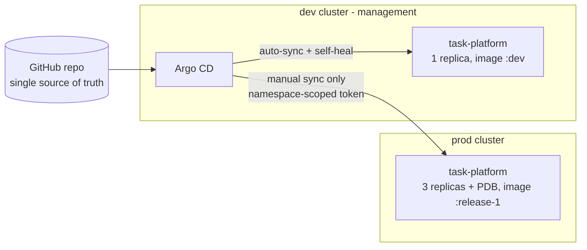

# GitOps Multi-Cluster Delivery with Argo CD


Git is the single source of truth for two Kubernetes clusters. **Dev** deploys itself and repairs any manual change; **prod** only changes when a release manager approves. Argo CD's guardrails and permissions are tested against real misuse on every run.

The workload is the hardened app from [hardened-k8s-platform](https://github.com/jaymeeljr/hardened-k8s-platform), built from [secure-cicd-pipeline](https://github.com/jaymeeljr/secure-cicd-pipeline).

## Architecture



## How changes flow

| | Dev | Prod |
| --- | --- | --- |
| Sync | Automatic on every Git change | Manual, by `release-managers` only |
| Manual `kubectl` change | Reverted by self-heal | Flagged as drift (OutOfSync), not overwritten |
| Image | `task-api:dev` | `task-api:release-1` (promote by editing the tag in a PR) |
| Shape | 1 replica | 3 replicas + PodDisruptionBudget |

Both environments come from one [`ApplicationSet`](argocd/applicationset.yaml) and one Kustomize base with [`dev`](apps/task-platform/overlays/dev) and [`prod`](apps/task-platform/overlays/prod) overlays.

## Security design

**Argo CD has no cluster-admin on prod.** `argocd cluster add` normally grants it. Here Argo CD reaches prod with a ServiceAccount whose Role covers only the `task-platform` namespace and only the object kinds the app needs ([`bootstrap/prod-argocd-access.yaml`](bootstrap/prod-argocd-access.yaml)). The token is generated at bootstrap and never stored in Git. If Argo CD were compromised, the blast radius is one namespace.

**The AppProject is a guardrail even for people with Git write access** ([`argocd/project.yaml`](argocd/project.yaml)):
- one approved source repository
- one destination namespace per cluster
- zero cluster-scoped resources; only Deployments, Services, ConfigMaps, ServiceAccounts, NetworkPolicies and PDBs
- Secrets, RBAC and quotas stay with the platform team ([`bootstrap/`](bootstrap/))

**Argo CD watches only what it manages** ([`argocd/argocd-cm.yaml`](argocd/argocd-cm.yaml)). The first CI run failed because Argo CD tries to list every resource type in a namespace, including Secrets, and the minimal prod Role denied it. Instead of widening the Role, Argo CD's resource inclusions were narrowed to the kinds the platform manages.

**Argo CD RBAC** ([`argocd/rbac-cm.yaml`](argocd/rbac-cm.yaml)): read-only by default; developers sync dev only; release managers sync prod; nobody but admin can delete apps, exec into pods or edit projects.

## What CI proves

The static job renders each environment exactly as Argo CD will and checks it with kubeconform, Checkov and OPA policies. The end-to-end job creates two kind clusters, installs Argo CD, registers prod and then runs:

| Suite | Checks |
| --- | --- |
| `test-rbac-policy.sh` | 8 Argo CD permission cases, evaluated offline with `argocd admin settings rbac can` |
| `test-prod-access.sh` | Argo CD's prod identity can deploy in its namespace but cannot read Secrets, touch `kube-system`, create ClusterRoleBindings, delete namespaces, exec or raise its own quota |
| `test-sync.sh` | Dev syncs itself; prod stays undeployed until approved, then runs 3 ready replicas of the pinned release |
| `test-drift.sh` | Manual scale and a deleted NetworkPolicy are reverted in dev; in prod the same change is reported, left alone, then fixed by a re-sync |
| `test-guardrails.sh` | Apps targeting `kube-system`, an unapproved repo, or containing a ClusterRole/Secret are all refused, and nothing is created |

## Run it locally

Requires Docker, kind and kubectl, with `secure-cicd-pipeline` cloned next to this repo.

```bash
./scripts/bootstrap.sh ../secure-cicd-pipeline
for t in tests/test-*.sh; do bash "$t"; done
kubectl --context kind-dev -n argocd port-forward svc/argocd-server 8080:443   # UI at https://localhost:8080
kind delete clusters dev prod
```

## Known trade-offs

- Argo CD runs in the dev cluster to keep CI small; production setups usually give it a dedicated management cluster.
- Argo CD keeps full access to the cluster it runs in (`in-cluster`); the least-privilege model is applied to the remote prod cluster.
- Kind's default CNI does not enforce NetworkPolicy; enforcement is tested in `hardened-k8s-platform` with Calico.
- Secrets are out of scope for Git here; Sealed Secrets or External Secrets Operator would be the next step.

## Author

Jamil Qarahmadov — DevSecOps Engineer · cemil.qarahmedov@gmail.com
